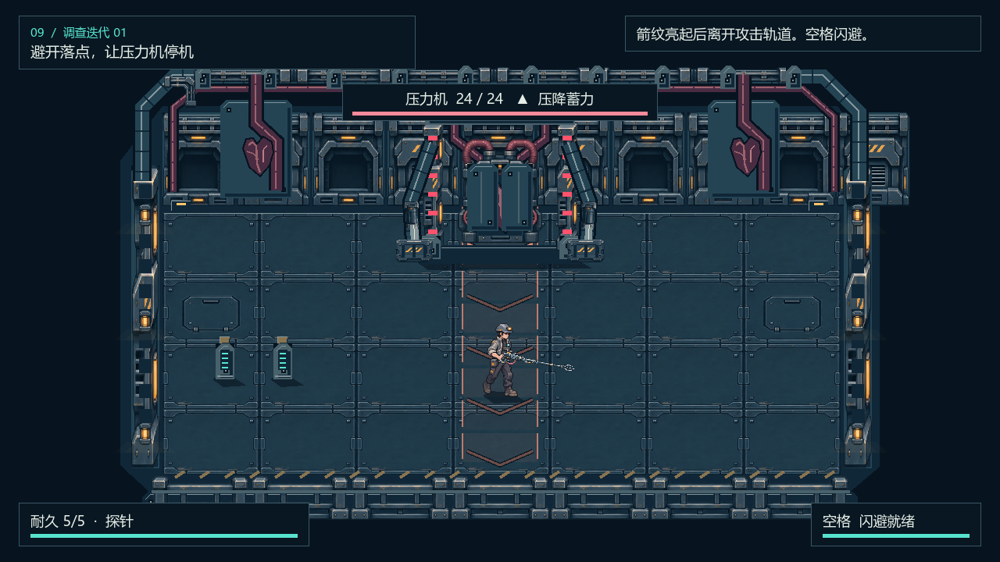

# 夜班回路（开发代号，正式名称待定）

旧标题《牛马公司》停用，正式标题候选见[世界观圣经](design/WORLD_BIBLE.md)。主角固定称为 **09**。

一款以工厂调查、战斗构筑和回溯为核心的 Roguelike RPG。停机后的第一通求救把你引进厂里。系统给你一件工具，帮你打停压力机。等你带着日志回到进厂那一刻，原先锁着的门可以打开，门后的记录却写着你还没做过的选择。

**当前版本为 0.2.3，更新了武器动作、混音、界面和场景碰撞。** 在标题选择「开始首组远征」，从中心选短弧或探针长枪。完成三个小怪关和压维守卫，带心核返回中心合并，再用工料购买或强化武器，携带新构筑进入肺叶入口。压力机、日志、回溯与 B-17 序章可从「开始调查」进入。

用户确认的是样稿风格，随后否定了整张房间图和静态人物图直接入景的做法。当前改为独立地板、墙段、立柱、管线和机械部件组合，按脚点处理遮挡；09 和三类小怪使用真实姿态序列，门扇、护板、活塞和锤臂独立运动。场景渲染为 1280×720，玩法逻辑坐标和规则不变。PixelFX 的攻击、命中、受伤、闪避、死亡与收集反馈继续运行。[中心实机](qa/expedition-graft.png) · [武器铺实机](qa/expedition-shop.png) · [再出发实机](qa/expedition-rearmed.png)

图像采用细分钢板、检修服与湿件材质，保留交互青、路径琥珀和暖色轨迹预警。当前使用 64 个角色／敌人姿态帧及 12 个场景模块。主角前后行走、挥击、架枪、闪避、受伤和倒地已接状态；三类小怪有行走、蓄力、释放、受击和死亡姿态。完整方向、握持与帧间连续性仍需精修。[动态实机](qa/modular-motion.gif) · [当前制作记录](rpg/art/modular/PROMPTS.md) · [美术圣经](design/ART_DIRECTION.md)。

完整战役的背景已收束：能源枯竭的世界囚禁了前来救世的圣骸，工厂由它仍然活着的身体改造而成。人们口中的「天使」是古神的伪装，它借改造方案让人类为自己建造孵化场。最初的求救确实来自圣骸；拥有潜在神性的男主接受系统升级，以为正在救人，却在推进系统背后古神胚胎的孵化。后续内容优先扩展 B-17 检修井、普通敌人、强化与选择后果，均尚待实现。

完整一轮由 **21 个小怪关、7 个守门人关和 1 个终极 Boss 关**组成。每组通关后返中枢接驳器官、恢复和换装。现有试玩开放 01–05 关。[完整 29 关路线与周目设计](design/LEVEL_ROUTE.md)

本轮增加 120ms 输入缓冲、短弧三段挥击节奏、按武器区分的顿帧与击退，以及四通道音效。碎屑会落地反弹、液滴留下痕迹；战斗房间边侧的冷却罐可打碎并触发局部连锁。铆枪示踪停在接触点，攻击轨迹以独立地面图形显示。当前保持原基础伤害与工料规则，冷却罐不造成伤害、不发奖励。[实机动态](qa/combat-feel.gif) · [战斗与画面方向](design/COMBAT_FEEL.md)。

扑击体以虚线落点圈和残影提示跳扑，感染夜班工以窄轨迹提示扳手挥击，免疫守卫以扇形提示盾击。三种预警由实际命中形状绘制。 [实机动态](qa/enemy-trajectories.gif)

## 试玩

Windows 上双击 [试玩重构版.cmd](试玩重构版.cmd)。也可在 **Godot 4.5.1** 中导入 [rpg/project.godot](rpg/project.godot)，等待素材导入后按 **F5**。

| 操作 | 键位 |
| --- | --- |
| 移动 | WASD |
| 交互 | E |
| 选择模块 | 1 / 2 或点击按钮 |
| 攻击 | 左键瞄准，或 J 朝面向方向出手 |
| 闪避 | 空格 |
| 暂停 | Esc |

沿箭纹两侧离开压力机的纵向压降或横扫轨道，等青色护板打开再攻击。停机后去右侧日志终端取证。完整操作、检查点和设置见 [试玩说明](rpg/README.md)。

远征中清理敌人后沿琥珀灯前往右上出口；第四关结束返回中心。中央是脏器接驳台，左侧是武器铺，右侧是出发口，均靠近后按 E。武器铺每件 12 工料、首次强化 10、单次刷新 6；首组总奖励 30 工料。退出继续保留装备、接驳和商店库存，未完成遭遇从该关入场检查点恢复；战败会清空该次远征。

压力机的压降与横扫都有独立的蓄力和落击表现。按住移动方向并按空格可短闪，攻击接触时闪避会给出“擦身闪避”反馈，底部显示恢复时间。

命中 Boss 会留下装甲裂纹。主角受伤时有局部闪光与踉跄，耐久耗尽后倒地、武器脱手，再进入重试。[受伤实机](qa/player-hurt.png) · [倒地实机](qa/player-dead.png)

短弧电切刃擅长近身扇扫，探针长枪负责远距窄束，压力铆枪提供高频单体点射。三件武器各有持握造型、出招动作与命中反馈。[武器选装](qa/weapons.png) · [短弧实机](qa/combat-arc.png) · [探针实机](qa/combat-probe.png)

格挡用冷灰破环，组织和装甲命中分别用玫红与琥珀火花。Boss 停机一击有独立的碎环和接触停顿。敌人预警与闪避继续计时，暂停页可单独调整震动和闪光。[实机动图](qa/combat-feel.gif)

## 项目入口

- [游戏策划案](design/GAME_DESIGN.md)涵盖完整游戏方向、首轮玩法、回溯规则和剧情揭示。
- [产品范围](design/PRODUCT_BRIEF.md)、[美术圣经](design/ART_DIRECTION.md)和[视觉目标](design/VISUAL_TARGETS.md)约束制作。
- [开发路线图](design/ROADMAP.md)、[构建说明](design/BUILD_BRIEF.md)和[协作流程](CONTRIBUTING.md)供开发交接。
- [游戏开发 Agent 技能索引](design/GAME_DEV_SKILLS.md)按用途列出上游技能、已安装状态和按需部署方法。
- [QA 报告](qa/QA_REPORT.md)记录实机路径和未覆盖项。[更新日志](CHANGELOG.md)记录版本变化。
- [项目总结与策划内容方案](项目总结与策划内容方案.md)保留早期复盘与提案；涉及作品方向和后续范围时，以当前策划、世界观圣经与路线图为准。
- [世界观圣经](design/WORLD_BIBLE.md)确认背景、09、七组四关、七次中心合并与古神降临的结构；武器铺和构筑草案见游戏策划，正式标题与具体参数待定。

在仓库根目录执行 `& ./rpg/验证.ps1` 可复现 Windows Godot 的原序章回归与首组远征验证。完整战役、后续周目、独立 Windows 包和 Steam Demo 仍待开发。
