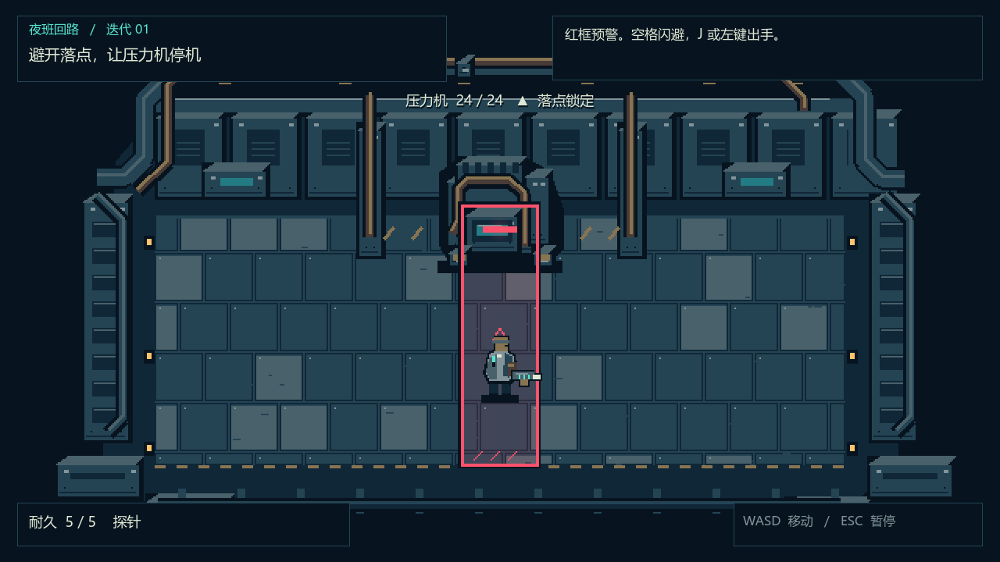

# 牛马公司 · 夜班回路

一款以工厂调查、战斗构筑和回溯为核心的 Roguelike RPG。停机后的第一通求救把你引进厂里。系统给你一件工具，帮你打停压力机。等你带着日志回到进厂那一刻，原先锁着的门可以打开，门后的记录却写着你还没做过的选择。

**当前版本为 0.1 可玩切片。** 你可以选择短弧或探针，打停压力机，查出求救线路，再带原件回溯并打开 B-17。采用高对比发光像素美术，切片以斜俯视 2D 和小型实时战斗验证手感。

## 试玩

Windows 上双击 [试玩重构版.cmd](试玩重构版.cmd)。也可在 **Godot 4.5.1** 中导入 [rpg/project.godot](rpg/project.godot)，等待素材导入后按 **F5**。

| 操作 | 键位 |
| --- | --- |
| 移动 | WASD |
| 交互 | E |
| 选择模块 | 1 / 2 或点击按钮 |
| 攻击 | 左键瞄准，或 J 朝面向方向出手 |
| 闪避 | 空格 |
| 暂停 | Esc |

避开压力机的红框，等青色护板打开再攻击。停机后去右侧日志终端取证。完整操作、检查点和设置见 [试玩说明](rpg/README.md)。

短弧是近身的棘齿切割器，探针是远距的脉冲测距枪。两件武器各有持握造型、出招动作与命中反馈。[武器选装](qa/weapons.png) · [短弧实机](qa/combat-arc.png) · [探针实机](qa/combat-probe.png)

## 项目入口

- [游戏策划案](design/GAME_DESIGN.md)涵盖完整游戏方向、首轮玩法、回溯规则和剧情揭示。
- [产品范围](design/PRODUCT_BRIEF.md)、[美术圣经](design/ART_DIRECTION.md)和[视觉目标](design/VISUAL_TARGETS.md)约束制作。
- [开发路线图](design/ROADMAP.md)、[构建说明](design/BUILD_BRIEF.md)和[协作流程](CONTRIBUTING.md)供开发交接。
- [QA 报告](qa/QA_REPORT.md)记录实机路径和未覆盖项。[更新日志](CHANGELOG.md)记录版本变化。

在仓库根目录执行 `& ./rpg/验证.ps1` 可复现 Windows Godot 验证。完整战役、后续周目、独立 Windows 包和 Steam Demo 仍待开发。
