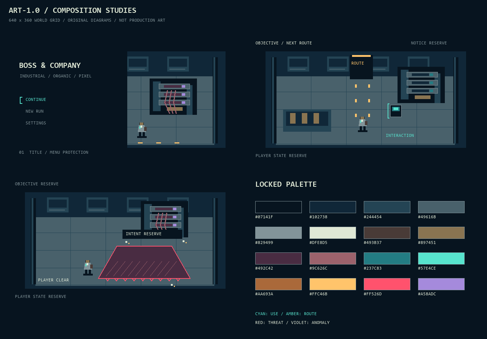

# RPG 美术目标包 v1.0

targetFinish: 可在 Windows Godot 中完整游玩的重构切片，采用 ART-1.0 像素场景、角色、HUD 与反馈。

依据为 [美术圣经](ART_DIRECTION.md)。下列原创构图草图用于约束 0.1 及后续资产的色板、层次与留白。草图用英文标示功能区，切片 UI 使用中文。

## 0.1 实机对照

Windows Godot 1280×720 代表帧：[标题](../qa/title.png) · [探索](../qa/exploration.png) · [压力机预警](../qa/combat.png) · [旁路结算](../qa/outcome.png)。测试路径与限制见 [QA 报告](../qa/QA_REPORT.md)。

## 三类目标视图与逐项量表

| 项目 | 01 标题 / 首屏 | 02 探索 / 交互 | 03 最高压力 / 战斗 |
| --- | --- | --- | --- |
| 路径 | `visual-targets/01-title.png` | `visual-targets/02-exploration.png` | `visual-targets/03-pressure.png` |
| 玩家动作/状态 | 继续或开始；无战斗压力 | 位于路线分叉前，看到通路与终端 | 玩家位于危险区外；敌方意图与边界持续可读 |
| 构图/机位 | 固定斜俯视，左侧菜单、右侧供给架 | 同机位；中央通路，右侧交互 | 同机位；敌人上方，玩家左下 |
| 焦点顺序 | 菜单焦点→供给架→微小工人 | 玩家→地灯路线→终端 | 玩家/危险边线→敌人→状态 |
| 远中近层 | 远处墙箱、中层夹架、近处工人有明暗差 | 暗墙、低纹理地面、近处机器不混成一层 | 暗墙退后，危险区贴地，攻击部件高于地面 |
| 轮廓 | 人与装置在缩略图中分离 | 主角工具包与工牌位置清楚 | 敌人与玩家不靠同一人形换色区分 |
| 材质 | 钢板直线与有机连接形成结构差异 | 走道纹理弱于人物，黄铜管箱不自发光 | 肉灰为实体，警红只承担危险提示 |
| 线条 | 源像素整齐，不模糊缩放 | 接触边界稳定，括号独立于实体轮廓 | 两像素危险边界不被斜纹/粒子切断 |
| 色光 | 菜单青亮，机器紫小面积 | 路灯琥珀，终端青；关闭辉光仍成立 | 红色危险优先，紫色退为小窗口 |
| HUD | 标题和菜单不盖主体机器 | 目标/通知/状态三块独立预留 | 意图文字有深底；状态不覆盖玩家脚点 |
| 运动提示 | 单窗口慢亮；不连续闪屏 | 地灯引导，终端括号短收拢 | 前摇/危险持续时间取规则；效果在边线内外均须让路 |

每张图都须在下一轮正式资产替换时重新核对上述条目。当前图只提供构图、色板与功能层次证据，人物美术、材质精修、中文排版、运动效果不在“已验证”范围。

## 可直接否决的失败例

- 正式场景仍只有基础几何拼装感：缺少可辨的检修接缝、承重结构、接口与使用痕迹；不能把本次简图当成成品。
- 不看 HUD 就找不到通路/交互，或菜单与机器争夺第一焦点。
- 前景、中景、远景用同一亮度和纹理密度，人物像贴在地面上。
- 警戒地面与背景血肉同色同形，关闭 glow 后看不见危险边界。
- 中文正文被压进世界低分辨率层，或 150% 字号挡住按钮/人物。

## 来源、权利与验证状态

参考输入：用户本轮提供的 `codex-clipboard-99fc66dd-f2aa-48b7-89e5-097e964a2d95.png`。只观察光色、块面与尺度关系；未复制、裁切、描摹或嵌入其像素。原图来源/发行权未知，不收入生产素材。

本目录三幅图与色板由 `visual-targets/draw_studies.py` 用 Pillow 绘制原创构图示意，使用 Windows 本机 Consolas 作为说明文字，不随游戏分发字体。代码、PNG 与 `visual-targets/SHA256SUMS.txt` 持久保存在工作区。此包不含第三方角色、徽标或资产。

已检查：文件可生成、640×360 尺寸一致、示意图基础色来自同一色板、三类视图和功能留白存在。待验：精修样张、中文字体许可与覆盖、文字对比、色觉模拟、720p/1080p 实机、动效叠加、像素滚动稳定性、最终镜头选择。所有表现时长为方向提案，未当作实机测试结论。
